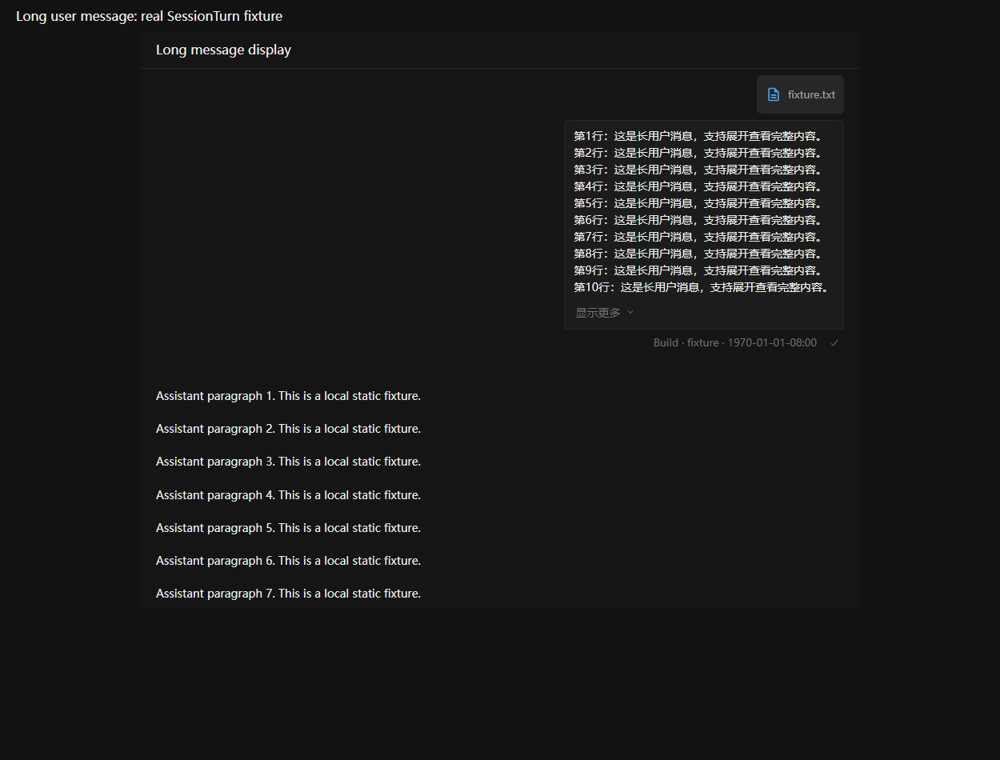
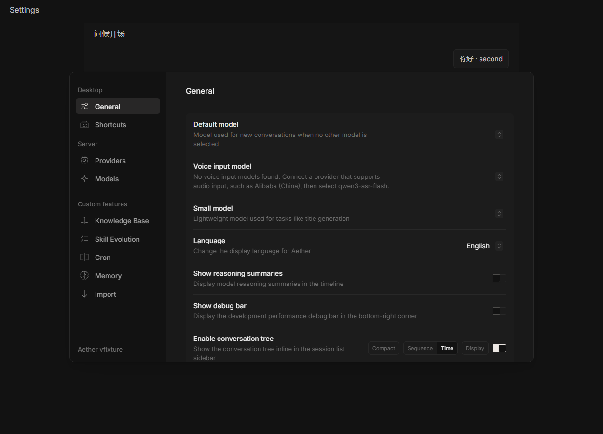

# 对话展示与自定义功能

设置导航分为“桌面”“服务器”“自定义功能”。服务器保留提供商和模型；知识库、Skill 自进化、Cron、Memory 和导入位于自定义功能。

## 自动收起历史回复

“通用 → 自动收起历史回复”默认开启，保存于客户端设置。进入会话和加载更早消息时，较早完成的回复会自动收起，最新回复保持展开。追加新消息不会自动收起已经展开的轮次。

关闭后只展开自动收起的回复，手动收起、手动展开及全部展开／收起仍可使用。重新打开会话时按照设置重新推导默认展示状态。

消息列表顶部、用户消息吸顶位置和消息锚点定位统一保留 8px 间距。

多行用户消息吸顶时完整保留气泡，不再向标题栏下方裁切。消息连同附件和操作区高到无法放入视口时，使用正常滚动，避免挡住回复；调整窗口后会重新判断。

## 自动收起长用户消息

“通用 → 自动收起长用户消息”默认开启，独立于历史回复的自动收起设置。长用户消息按实际排版显示约 10 行正文，可使用“显示更多／收起”逐条切换；附件和消息操作仍然可见，复制和发送始终使用完整原文。

关闭后完整显示用户消息，重新开启后恢复默认折叠。手动展开状态在当前消息挂载期间保留，窗口宽度变化不会重置；重新进入会话或消息内容改变后，按设置重新推导默认状态。

展开后消息过高时采用正常滚动，收起或调整窗口后重新判断是否可以完整吸顶。此设置保存在当前客户端，不修改服务端消息数据。

## Skill 自进化与知识库

两个总开关均作用于当前服务器，未明确配置时默认关闭。已有明确保存的开启或关闭选择继续生效，管理员配置仍保留原有的最高优先级。不同服务器各自保存配置，同一服务器的窗口通过事件同步开关状态。

```json
{
  "skills": { "evolution_enabled": true },
  "knowledge": { "enabled": true }
}
```

在对应设置页开启后，输入框右下角显示快捷入口；关闭时隐藏。知识库使用书本图标，Memory 保留大脑图标。

- 关闭 Skill 自进化会停止新的自动评审及维护，保留已生成技能和配置。普通 Skill 使用仍受原有技能开关管理，已运行的评审可以完成。
- 关闭知识库会停止新的自动发现、统计刷新、索引和检索；后续对话不附带知识库上下文，服务端也检查总开关。保留已有库、索引和会话选择，重新开启后可以继续使用。
- 已运行的 AI 回复不会因切换开关被终止；客户端取消不再需要的知识库请求，已经开始的服务端单次操作允许收尾。
- 知识库元数据读取失败时不自动保存空状态，也不能修改尚未成功恢复的库列表。设置页和知识库弹窗提供重试入口，关闭功能时也可以恢复已保存配置。保存开关失败会显示错误并保留原状态。

开关通过原有全局配置接口更新，使用 `global.config.updated` 事件通知客户端刷新配置，不需要重启或轮询，也不会向事件广播配置中的凭据。

## 界面示例

以下截图来自隔离验证页面，使用实际 UI 组件与测试数据。




