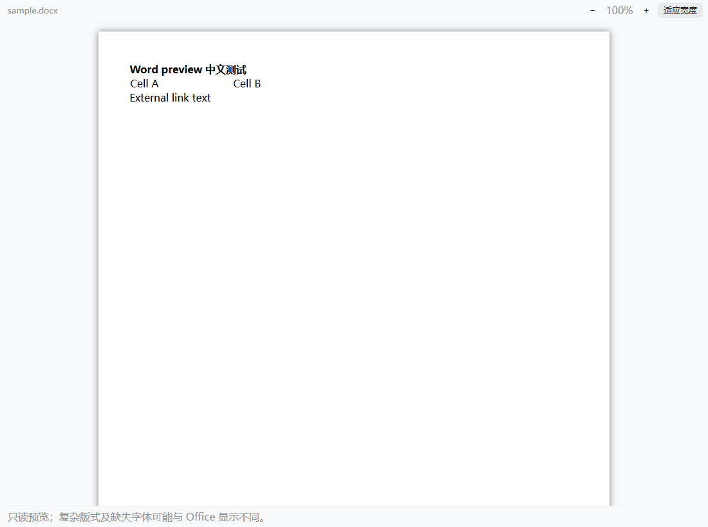
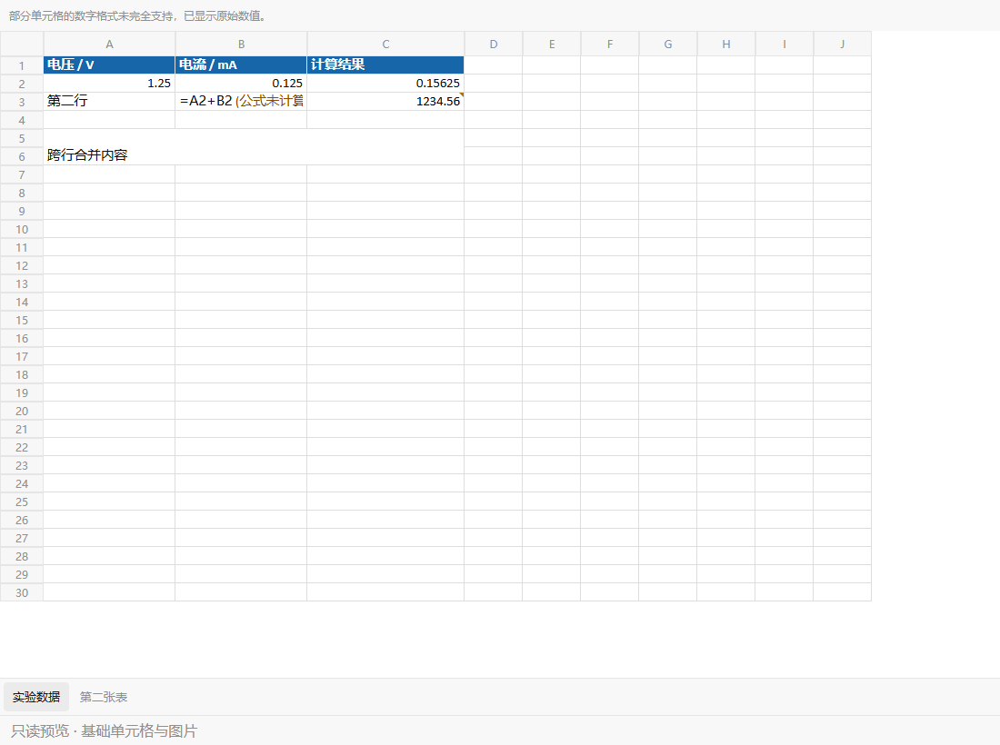
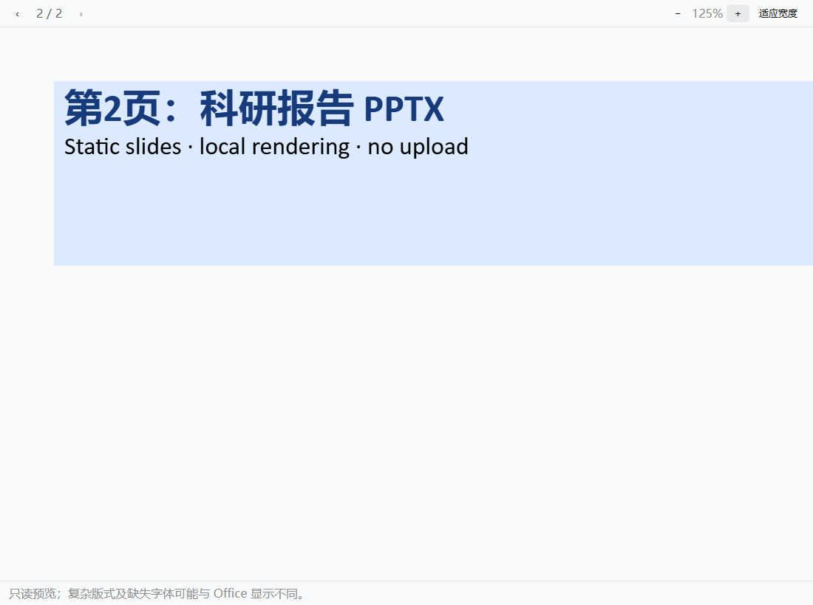
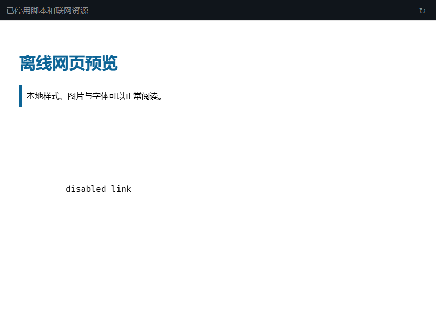

# Office 与 HTML 文件预览

Aether 可以在文件标签中只读查看 `.docx`、`.xlsx`、`.pptx`、`.html` 和 `.htm`。文件在本地或所连接的 Aether 服务器读取，不上传到在线 Office 服务，无需安装 Office 或 LibreOffice。

## 查看内容

| 格式  | 支持内容与操作                                                                 | 第一阶段限制                                                                       |
| ----- | ------------------------------------------------------------------------------ | ---------------------------------------------------------------------------------- |
| Word  | 正文、表格、图片、基础样式、分页标记、缩放、适应宽度                           | 不保证与 Word 自动分页或复杂版式完全一致，字体取决于本机                           |
| Excel | 多工作表、只读虚拟网格、基础样式、合并单元格、嵌入图片、数字格式、公式缓存结果 | 不计算公式；没有缓存结果时显示公式及未计算提示；图表、条件格式和透视表不做完整还原 |
| PPT   | 静态幻灯片、基础图形、文字、图片、表格及库支持的图表、翻页和缩放               | 不播放动画、视频或外部媒体；复杂 SmartArt、EMF、特效及缺失字体可能显示不完整       |
| HTML  | 静态网页、内联样式、配套 CSS、图片、字体、响应式布局、源码切换和刷新           | 不执行脚本，不补取在线资源；依赖 JavaScript 才生成的内容不会出现                   |

旧版 `.doc`、`.xls` 和 `.ppt` 不在本阶段范围内。预览不会改写 Office 文件。

## HTML 与编辑草稿

打开 HTML 默认显示网页，顶部可以切换“预览／源码”。源码沿用现有编辑、保存、取消及冲突处理；切换视图不会保存或丢弃草稿。预览采用当前有效草稿，包括空草稿，关联 CSS 也会采用同一工作区内有效的编辑草稿。与磁盘基线冲突的草稿仍需按原有提示恢复或处理。

相对资源地址以 HTML 或 CSS 所在目录为基准，`/assets/...` 以当前工作区根为基准。支持保存网页常见的 `page.html` 加 `page_files/` 结构。文件系统名称保持原样，网页 URL 路径只解码一层，避免字面 `%20`、中文及 `#` 等名称被错误改写。

只有当前预览需要的 CSS、图片和字体会被读取。缺失或被阻止的资源显示数量提示，已有正文继续显示。资源修改复用现有文件事件，可以用刷新按钮重新读取；不另开常驻网页服务器或全工作区扫描。

CSS 会保留解析器能够恢复的有效规则，包括嵌套 `@supports`；无法安全解析的片段仅在所在声明或规则内跳过，不因此删除整份样式表。状态栏分别报告资源读取失败、已停用内容与不支持的样式片段。网页没有一同保存的字体或图片仍可能缺失，预览不会联网补取。

HTML 在无脚本、无同源权限的 iframe 中显示。解析阶段使用不创建浏览器 DOM 的 HTML/CSS 语法树；清理脚本、事件、嵌入页面、表单提交、自动跳转及外链资源。CSS 内联，图片和字体转换为数据地址。链接只保留同页锚点。预览内容无法持有 Aether 的鉴权凭证或调用文件 API。

## 按需加载与释放

各格式组件及其解析库在打开相应文件后才加载。Excel 和 HTML 使用各自的按需 Worker；Excel 只把可见区域的数据传回界面，PPT 延迟解析和挂载幻灯片。Office 字节和 HTML 资源不会写入持久草稿缓存。

PPT 视口预留稳定的滚动条空间，避免窄面板中窗口化渲染使滚动条反复出现、消失并触发重绘循环。面板缩窄、拉宽或从隐藏状态恢复后，仍按实际可用宽度适应显示。

开发模式中，原生 ESM 预览依赖排除在 Vite 自动优化之外，仅显式预构建必要的 CommonJS 依赖，避免首次打开文件时重新优化依赖并刷新整窗。首次建立开发缓存仍有 Node 端编译成本；浏览器不会因此提前下载预览库或启动 Worker，生产构建仍保持动态分包。正常的源码热更新与预览初次读取、解析的局部加载提示不受此规则影响。

开发依赖解析的定向回归可从 `packages/app` 运行 `bun test ./script/preview-deps.test.ts`，分别检查网页版与 Electron renderer 的真实依赖优化结果，不启动 Aether 或浏览器。

切换或关闭预览会取消读取、终止 Worker、销毁 PPT 页面和图表、回收对象 URL、移除 iframe 与监听。旧结果不会覆盖新文件。Word 库没有可抢占的解析接口，已开始的同步解析不能由关闭操作中断；关闭后会拒绝其后续输出并清除视图。浏览器可以缓存已加载的模块代码，不能把文档资源释放理解为强制卸载模块或立即归还全部进程内存。

本阶段对 Office 输入和每次配套资源读取设置 **64 MiB 字节预算**，在已知长度时预先检查，未知长度时在流读取过程中检查并取消超限读取。HTML 另限制资源图为 256 项、CSS 递归深度为 16 层、单项 CSS 为 4 MiB、累计读取资源为 64 MiB；PPT 沿用解析库的推荐 ZIP 解压预算。Excel 解析超时为 30 秒，HTML 为 45 秒，失败可以重试。

这些是防止无界读取或递归的工程预算，**不是经过测量的卡顿临界值，也不是内存峰值上限**。压缩后的体积不能代表解析后的大小；读取合并、解压、字体、图片及工作簿模型仍会额外占用内存。

## 实现与验证

Office 沿用 metadata 和带鉴权的原始字节读取。HTML 资源使用 `GET /file/preview/resource?path=...&directory=...`，仅允许当前工作区内的 CSS、图片和字体，检查真实路径并拒绝目录穿越、符号链接及 junction 越界。原 `/file/raw` 的 HTML/SVG 下载隔离保持不变。

使用 `docx-preview@0.4.1`、`exceljs@4.4.0`、`ssf@0.11.2`、`@aiden0z/pptx-renderer@1.4.0`、parse5、css-tree 和 TanStack Virtual。许可证及相关声明随网页资源提供于 `preview-licenses.txt`。

定向验证覆盖格式路由、有效与空草稿、真实 Office 文件、单元格格式容错、日期系统、公式缓存、合并区域、图片、虚拟视口、HTML 离线资源、鉴权和真实路径边界、取消及迟到结果保护。隔离 Edge 浏览器验证了实际显示、控件和 Worker／对象 URL／iframe 清理，没有重启 Aether 或调用真实模型。

一个 20,000×20 单元格、约 1.17 MB 的合成 XLSX 在开发机器上的 Worker 加载约 1.5 秒，可视区 120 格读取约 4 毫秒。这只是单一样例，不代表所有文档的性能。

## 预览示例

以下截图来自隔离浏览器中的实际预览组件，使用合成测试文件与应用样式，不包含用户文档。

Word、Excel、PPT 与 HTML 示例

