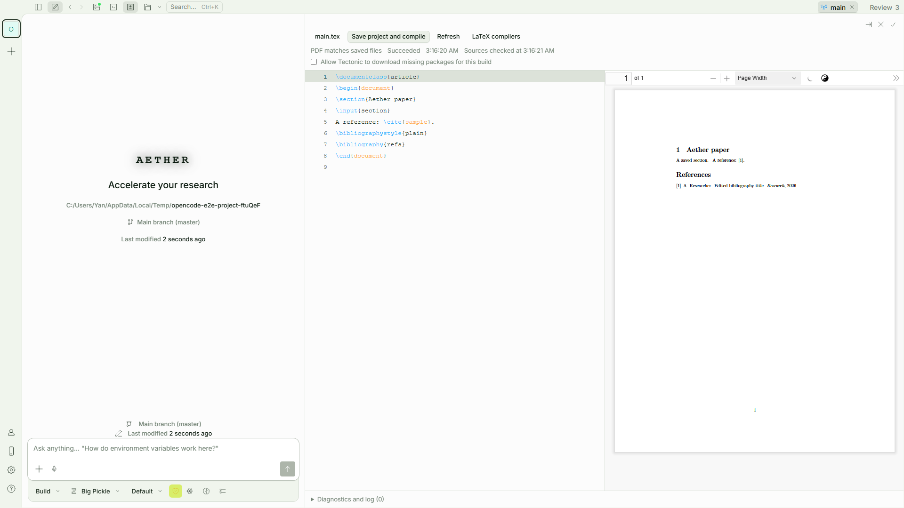
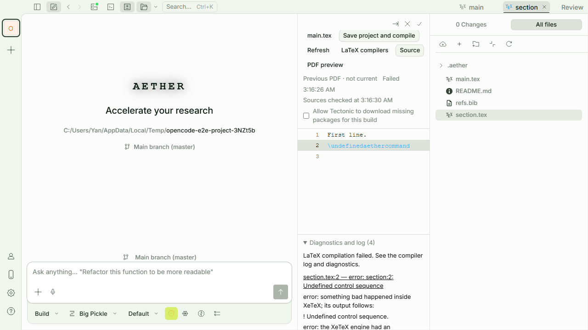
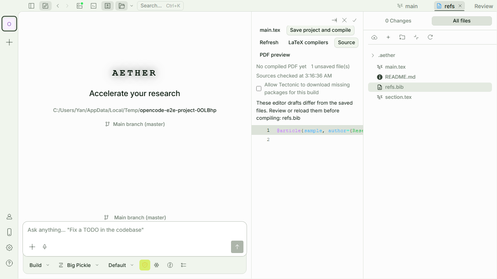

# LaTeX 论文编辑与编译

Aether 的 LaTeX 工作区在文件面板中连接源码编辑、主文档选择、编译诊断和 PDF 预览。编译读取已保存的工程文件，产物独立存储，不覆盖工程中已有的 PDF。

## 编译器

在设置的 **LaTeX 编译器** 页面，点击 **安装 Tectonic** 即可一键配置。Aether 从官方发布下载固定版本，核验 SHA-256、解压并检查程序后，放入自己的持久数据目录。界面显示阶段与下载进度，支持取消及失败重试；下载失败不会替换已有的受管安装。安装目标是运行 Aether 后端的机器，远程访问时不是浏览器所在电脑。

首版的一键配置使用 [Tectonic 0.17.0 官方发布](https://github.com/tectonic-typesetting/tectonic/releases/tag/tectonic%400.17.0)，支持 Windows x64、macOS x64/ARM64、Linux x64/ARM64。其他架构仍可手动安装和填写路径。它只安装 Tectonic 程序；宏包和字体仍受下文的编译资源规则约束。访问官方发布受网络限制时会报告失败，可以重试或改用手动配置。

一键配置不修改系统 PATH，不需要写入系统安装目录，也不在普通启动时联网查更新或启动常驻安装进程。安装结束后，留空的 Tectonic 路径会自动使用受管程序，其次查找 PATH。已有手填路径仍优先；路径无效时不会静默改掉它，可以清空并保存来使用自动发现。**检查/修复安装** 会检查现有受管程序，检查失败时重新下载；修复后保留旧程序目录，以免影响正在进行的编译，目前不自动清理这些旧目录。

latexmk 仍使用已有 TeX 环境，设置页提供 [TeX Live 安装说明](https://tug.org/texlive/acquire-netinstall.html)和 [MiKTeX 安装说明](https://miktex.org/download)。它需要相应的 TeX 引擎，Aether 不自动安装或修改整套系统 TeX 发行版。也可以手动安装 [Tectonic](https://tectonic-typesetting.github.io/book/latest/installation/)；自动发现失败时，在设置里填写可执行文件的完整路径。

首版支持 Tectonic 与 latexmk 的 pdfLaTeX、XeLaTeX 工作流。Tectonic 使用 XeTeX，不能保证兼容要求其他引擎的论文模板。LuaLaTeX 暂不支持；不能通过填写任意程序名来执行其他命令。

Tectonic 首次编译可能缺少宏包缓存。默认不下载缺失资源，需要联网准备资源时，在编译选项中允许下载。中文文档还需要正确的宏包和字体；出现缺字警告时，即使生成了 PDF，也应检查实际页面。

普通编译限时两分钟，允许下载资源的编译限时十分钟。控制台输出超过 8 MiB 会停止构建，面板保留最近约 256,000 个字符；单个成功 PDF 的大小上限为 100 MiB。

## 工程与主文档

打开 `.tex` 或 `.bib` 文件后，在 LaTeX 面板选择论文工程目录和主文档。工程目录应包含论文需要的章节、图片、数据与参考文献；大型代码仓库可以选择其中的论文子目录。

尚未保存工程绑定时，首次识别默认从整个 Aether 工作区开始。若工作区包含无关的大文件，扫描可能超过下述容量限制。此时面板会显示具体错误并展开 **LaTeX 工程** 设置；将工程目录改为论文所在的子目录，点击打开，再选择并绑定主文档。扫描失败会保留已经识别的工程信息，成功重试会清除加载错误。

显式保存的主文档绑定优先。没有绑定时，Aether 会识别 `% !TeX root = ...` 提示，再尝试寻找唯一的 `\documentclass` 候选；存在多个候选时需要选择，不会随意编译其中一个。root 提示中的缺失文件、循环或越界会报错。`% !TeX program` 只用于选择受支持的引擎。

主文档和编译选项保存在 Aether 的工程设置中，不向源码中插入配置。切换主文档或编译选项后，上一次 PDF 不能代表新的设置。

## 保存、编译与诊断

使用 **保存工程并编译** 保存该工程的工作区草稿，包括已经关闭标签页的草稿，再启动构建。保存沿用现有文件校验：磁盘内容发生变化或缺少可靠的草稿基准时，先解决冲突再编译。

多个文件逐个保存，不是一次原子事务。如果后续文件保存失败，前面的文件可能已经保存，面板会保留尚未保存的草稿并阻止编译。保存期间继续输入的新内容也会保留。

构建支持停止。同一工程在当前任务及其进程清理结束后才能再次编译。离开标签页不会取消正在进行的构建，返回后可以查看任务状态。

如果操作系统未能确认编译进程已经停止，Aether 会报告清理失败并保持该工程锁定。应先结束残留的编译器进程，再重启 Aether；不能把这类情况视为成功取消。

错误和警告显示在诊断列表中。能够定位到工程文件的诊断可跳到对应源码行；原始日志也可用于检查宏包、字体和参考文献问题。缺字、引用未解析等警告不会因为编译器退出码为零而隐藏。

宽面板可并排查看源码和 PDF，窄面板可切换显示。首版的源码定位用于编译诊断，尚不提供完整的 SyncTeX 双向定位。

## PDF 版本

每次构建使用独立的源码快照和输出目录。只有编译器成功退出、PDF 校验通过，服务才发布本次产物。失败或取消时保留上一次成功的 PDF，同时显示本次任务的状态；旧 PDF 不会被标成新结果。

快照内的全部输入作为保守依赖，按实际字节比较版本。修改章节、参考文献、图片或其他快照文件都可能使预览过期。磁盘检查结果带有检查时间，未保存草稿和外部文件冲突另外显示；这些状态不能互相代替。

单个工程快照最多包含 10,000 个文件系统条目、256 MiB 文件内容，目录深度上限为 32；主文档自动扫描最多检查 500 个 `.tex` 文件。遇到超限应缩小工程范围。符号链接和 junction 暂不支持。编译产物通过所属工作区和构建 ID 访问，不接受任意缓存文件路径。

快照包含未跟踪及被 Git 忽略的普通工程文件，包括作为插图的 PDF 和预生成的 `.bbl`。它排除 `.git`、`.hg`、`.svn`、`.aether`、`node_modules`、`.venv`、`__pycache__`、`.env` 和 `.env.*`；需要的输入应放在论文工程中正常的文件目录下。

## 当前边界

- 编译依赖本机安装的宏包、字体和引擎版本，不承诺与 Overleaf 的环境完全一致。
- 禁用 shell escape，latexmk 不读取项目 `.latexmkrc`，Tectonic 使用 `--untrusted`。这些限制不等同于完整的操作系统或文件系统沙箱；本机 TeX 引擎仍可能读取工程以外的可访问文件。
- 编译器可执行路径来自服务端全局配置、Aether 受管安装或 PATH 自动发现。工程内的注释和配置不能指定任意可执行程序。
- 预览与成功产物留在 Aether 管理的存储中；需要交付 PDF 时通过预览器下载。
- 历史成功 PDF 当前会持续保留，尚未提供自动磁盘清理策略。
- Overleaf 同步和实时协作不在本阶段范围内。

## 开发与验证

后端实现在 `packages/opencode/src/latex/`，接口位于 `/latex`。配置版本、源码快照 SHA-256 与编辑保存的 checksum 分别用于不同的检查，不能混用。SDK 使用 `packages/sdk/js/script/build.ts` 重新生成。

验证重点包括主文档歧义、跨目录边界、保存冲突、多文件与参考文献、中文缺字警告、编译中修改依赖、失败保留旧预览、取消和并发清理，以及跨工程产物访问。真实编译还应渲染 PDF 检查页面，不能只检查退出码。

浏览器回归位于 `packages/app/e2e/files/latex.spec.ts`。设置 `AETHER_E2E_TECTONIC` 为真实可执行文件路径，并通过 `AETHER_E2E_TECTONIC_CACHE` 指定已准备好所需宏包的缓存，才能执行这组离线编译用例；未指定编译器时它们会跳过。缓存只复制到各测试后端的隔离目录。

## 界面示例

以下截图来自真实浏览器与 Tectonic，使用临时论文测试工程。

