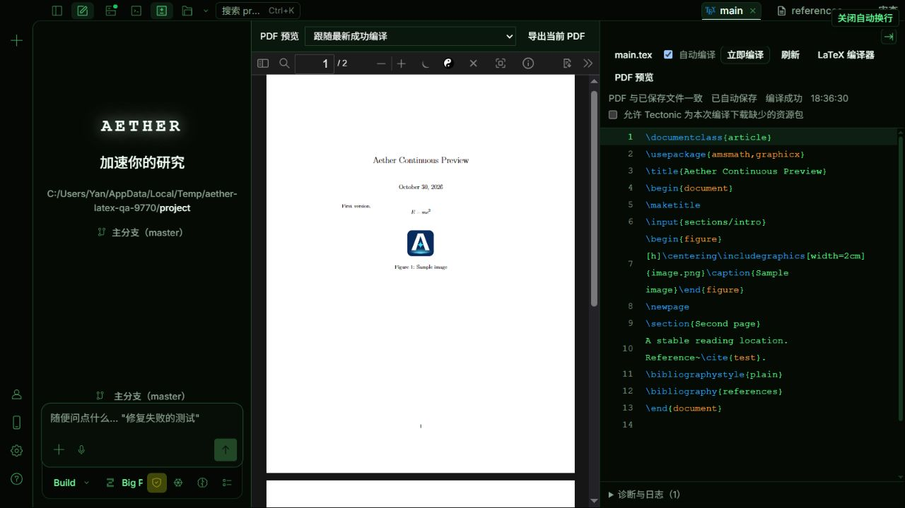

# LaTeX 论文编辑与编译

Aether 的 LaTeX 工作区将源码留在编辑栏，将编译 PDF 放入独立阅读视图，连接主文档选择、自动保存、编译诊断和阅读工具。无需创建聊天或启用 AI 后端即可使用。编译读取已保存的工程文件，产物独立存储，不覆盖工程中已有的 PDF。

## 编译器

在设置的 **LaTeX 编译器** 页面，点击 **安装 Tectonic** 即可一键配置。Aether 从官方发布下载固定版本，核验 SHA-256、解压并检查程序后，放入自己的持久数据目录。界面显示阶段与下载进度，支持取消及失败重试；下载失败不会替换已有的受管安装。安装目标是运行 Aether 后端的机器，远程访问时不是浏览器所在电脑。

首版的一键配置使用 [Tectonic 0.17.0 官方发布](https://github.com/tectonic-typesetting/tectonic/releases/tag/tectonic%400.17.0)，支持 Windows x64、macOS x64/ARM64、Linux x64/ARM64。其他架构仍可手动安装和填写路径。它只安装 Tectonic 程序；宏包和字体仍受下文的编译资源规则约束。访问官方发布受网络限制时会报告失败，可以重试或改用手动配置。

一键配置不修改系统 PATH，不需要写入系统安装目录，也不在普通启动时联网查更新或启动常驻安装进程。安装结束后，留空的 Tectonic 路径会自动使用受管程序，其次查找 PATH。已有手填路径仍优先；路径无效时不会静默改掉它，可以清空并保存来使用自动发现。**检查/修复安装** 会检查现有受管程序，检查失败时重新下载；修复后保留旧程序目录，以免影响正在进行的编译，目前不自动清理这些旧目录。

latexmk 仍使用已有 TeX 环境，设置页提供 [TeX Live 安装说明](https://tug.org/texlive/acquire-netinstall.html)和 [MiKTeX 安装说明](https://miktex.org/download)。它需要相应的 TeX 引擎，Aether 不自动安装或修改整套系统 TeX 发行版。也可以手动安装 [Tectonic](https://tectonic-typesetting.github.io/book/latest/installation/)；自动发现失败时，在设置里填写可执行文件的完整路径。

编译器路径保存在服务端全局配置目录的 `aether.integrations.jsonc`（默认 `~/.config/aether/`），避免旧版桌面端因不认识 `latex` 字段而启动失败。本分支仍能读取主配置中已有的 `latex`，独立文件中的设置优先；保存设置时仅将正在使用的主配置里的 `latex` 迁出。共享文件中已有的 `native` 会原样保留，但本分支不读取其设置、不解析其中的环境变量或文件占位符，也不提供 Codex 原生接入。Tectonic 程序及宏包缓存仍保留在各自的数据目录，不随配置文件迁移。此机制需要更新后端程序，只有前端热更新不会改变旧后端的保存方式。

若旧混合版本尚未完成迁移，主配置文件中仍含 `native` 等本分支不支持的字段，配置校验会拒绝加载，本分支不会自动删除这些字段。切换前应先在混合版本中保存设置完成迁移，或备份后将对应字段移入共享配置文件。

首版支持 Tectonic 与 latexmk 的 pdfLaTeX、XeLaTeX 工作流。Tectonic 使用 XeTeX，不能保证兼容要求其他引擎的论文模板。LuaLaTeX 暂不支持；不能通过填写任意程序名来执行其他命令。

Tectonic 首次编译可能缺少宏包缓存。默认不下载缺失资源，需要联网准备资源时，在编译选项中允许下载。中文文档还需要正确的宏包和字体；出现缺字警告时，即使生成了 PDF，也应检查实际页面。

普通编译限时两分钟，允许下载资源的编译限时十分钟。控制台输出超过 8 MiB 会停止构建，面板保留最近约 256,000 个字符；单个成功 PDF 的大小上限为 100 MiB。

## 工程与主文档

打开 `.tex`、`.bib`、`.sty`、`.cls` 或 `.bst` 文件后，在 LaTeX 面板选择论文工程目录和主文档。工程目录应包含论文需要的章节、图片、数据与参考文献；大型代码仓库可以选择其中的论文子目录。

首次识别优先查找当前目录及祖先目录已有的工程绑定，再识别 `% !TeX root`；没有提示时逐层浅查附近的主文档，不递归扫描无关的整个工作区。多个候选需明确选择。工程仍应包含全部输入；需要共享上层图片等资源时，可以手动调整工程根目录。扫描失败会显示具体错误并保留工程设置入口。

显式保存的主文档绑定优先。没有绑定时，Aether 会识别 `% !TeX root = ...` 提示，再尝试寻找唯一的 `\documentclass` 候选；存在多个候选时需要选择，不会随意编译其中一个。root 提示中的缺失文件、循环或越界会报错。`% !TeX program` 只用于选择受支持的引擎。

主文档和编译选项保存在 Aether 的工程设置中，不向源码中插入配置。切换主文档或编译选项后，上一次 PDF 不能代表新的设置。

## 保存、编译与诊断

保存工程设置后，默认开启 **自动保存并编译**。停止输入约一秒后保存工程内上述源码类型的草稿，包括已关闭标签的草稿；输入法组合期间暂停。自动保存不退出编辑状态、不改变光标。关闭开关后进入手动模式，修改保留为草稿，点击 **保存并编译** 或按 **Ctrl+S** 才保存当前工程的源码草稿并编译；重新开启后继续自动处理。关闭开关不会中断已经开始的保存或构建。离开页面前应先保存需要保留的修改。

主文档名称、刷新、LaTeX 编译器、PDF 预览等操作均使用按钮外观。点击主文档按钮展开工程设置，选择目录、主文档和编译工具后点击 **保存工程设置**。面板的 **帮助** 提供日常流程和各项操作说明。

工具区可以 **收起** 为显示主文档、保存与编译状态的紧凑栏，保留 **保存并编译**、运行中取消和 **展开** 操作。同一工程的 PDF 版本与导出行会一起收起；错误、冲突和预览过期等提示仍然显示。切换源码标签或聊天保留收起状态；新工程需要配置主文档时会展开。收起只影响界面，不会停止自动保存或编译；关闭编辑分栏后，独立阅读视图仍提供版本和导出操作。

保存使用文件 checksum 比较；外部程序或 AI 修改同一文件时暂停并提供 **比较并处理**，可查看磁盘与草稿，明确采用一方。比较期间再次修改会重新校验，不静默覆盖。编译资源下载许可只供下一次手动编译，不传递给后续自动构建。

多个文件逐个保存，不是一次原子事务。如果后续文件保存失败，前面的文件可能已经保存，面板会保留尚未保存的草稿并阻止编译。保存期间继续输入的新内容也会保留。

构建支持停止。同一工程同时最多一个运行任务；自动模式下期间修改合并为下一次最新请求。关闭源码标签或切换聊天不会停止保存和编译状态管理。自动模式切换到另一工程前先保存旧工程草稿，若存在冲突则先处理；手动模式切换工程不会自动写盘，草稿留在文件编辑状态中。

构建运行时每 500 毫秒检查一次完成状态，慢查询不会重叠，结束后停止轮询。停笔后的 1 秒等待仍用于合并输入；总刷新时间还取决于保存、编译和 PDF 渲染耗时。

如果操作系统未能确认编译进程已经停止，Aether 会报告清理失败并保持该工程锁定。应先结束残留的编译器进程，再重启 Aether；不能把这类情况视为成功取消。

错误和警告显示在诊断列表中。能够定位到工程文件的诊断可跳到对应源码行；原始日志也可用于检查宏包、字体和参考文献问题。缺字、引用未解析等警告不会因为编译器退出码为零而隐藏。

源码和 PDF 分别使用编辑与阅读分栏；编译产物不再嵌入源码面板。首版的源码定位用于编译诊断，尚不提供完整的 SyncTeX 双向定位。

## PDF 版本

每次构建使用独立的源码快照和输出目录，不复用上一轮编译中间文件。只有编译器成功退出、PDF 校验通过，服务才发布本次产物。失败或取消时保留上一次成功的 PDF，同时显示本次任务的状态；旧 PDF 不会被标成新结果。

快照内的全部输入作为保守依赖，按实际字节比较版本。修改章节、参考文献、图片或其他快照文件都可能使预览过期。磁盘检查结果带有检查时间，未保存草稿和外部文件冲突另外显示；这些状态不能互相代替。

切回窗口时会在后台重新检查磁盘。检查本身不表示源码已经修改，不会短暂显示预览过期；发现未保存内容、文件冲突或版本差异时才显示。检查失败会展示具体错误及未确认状态，不把失败当作文件已修改。

单个工程快照最多包含 10,000 个文件系统条目、256 MiB 文件内容，目录深度上限为 32；主文档自动扫描最多检查 500 个 `.tex` 文件。遇到超限应缩小工程范围。符号链接和 junction 暂不支持。编译产物通过所属工作区和构建 ID 访问，不接受任意缓存文件路径。

快照包含未跟踪及被 Git 忽略的普通工程文件，包括作为插图的 PDF 和预生成的 `.bbl`。它排除 `.git`、`.hg`、`.svn`、`.aether`、`node_modules`、`.venv`、`__pycache__`、`.env` 和 `.env.*`；需要的输入应放在论文工程中正常的文件目录下。

阅读视图成功加载新版本后才换版，保留页码、缩放和页内位置；页数减少时限制到有效页码。选区、截图或批注保存期间暂缓切换，加载失败保留旧 PDF。

同一文档换版时，暂时保留旧版本的可见页面画面，等新版对应区域完成绘制后再替换，减少整页闪烁。LaTeX 构建已有独立版本号，不受普通 PDF 文件更新的三秒刷新间隔限制。

批注按构建 ID 和 PDF SHA 保存，版本菜单可返回有批注的历史结果；不会将旧批注自动迁移到新排版。批注并发冲突会保留本地修改并暂停换版，明确重试或重新加载已保存的批注后恢复。文字和截图提问固定点击时的内容及构建来源；只有主动使用 AI 操作才关联聊天，编译结果不自动预读。

**导出当前 PDF** 导出正在显示的成功构建。若源码有更新，会提示预览过期；不会混合正在编译的版本。预览器仍支持导出带批注 PDF。普通成功产物保留最近三份，当前最新构建、有批注、被提问引用或具有有效查看租约的版本额外保留。查看租约每三十秒续期、九十秒到期，关闭后可释放；失败日志保留最近二十项，未知或损坏的历史文件不自动删除。

## 当前边界

- 编译依赖本机安装的宏包、字体和引擎版本，不承诺与 Overleaf 的环境完全一致。
- 禁用 shell escape，latexmk 不读取项目 `.latexmkrc`，Tectonic 使用 `--untrusted`。这些限制不等同于完整的操作系统或文件系统沙箱；本机 TeX 引擎仍可能读取工程以外的可访问文件。
- 编译器可执行路径来自服务端全局配置、Aether 受管安装或 PATH 自动发现。工程内的注释和配置不能指定任意可执行程序。
- 预览与成功产物留在 Aether 管理的存储中；需要交付 PDF 时通过预览器下载。
- 有批注或提问引用的版本持续保留，当前没有自动迁移批注或删除引用的管理界面。
- 当前是停止输入后的完整 PDF 自动编译，不是逐字即时排版。rtex、LuaLaTeX、SyncTeX 双向定位、Overleaf 同步和实时协作不在本阶段范围内。

## 开发与验证

后端实现在 `packages/opencode/src/latex/`，接口位于 `/latex`。配置版本、源码快照 SHA-256 与编辑保存的 checksum 分别用于不同的检查，不能混用。SDK 使用 `packages/sdk/js/script/build.ts` 重新生成。

验证重点包括主文档歧义、跨目录边界、保存冲突、多文件与参考文献、中文缺字警告、编译中修改依赖、失败保留旧预览、取消和并发清理，以及跨工程产物访问。真实编译还应渲染 PDF 检查页面，不能只检查退出码。

浏览器回归位于 `packages/app/e2e/files/latex.spec.ts`。设置 `AETHER_E2E_TECTONIC` 为真实可执行文件路径，并通过 `AETHER_E2E_TECTONIC_CACHE` 指定已准备好所需宏包的缓存，才能执行这组离线编译用例；未指定编译器时它们会跳过。缓存只复制到各测试后端的隔离目录。

## 界面示例

当前版本的独立阅读分栏与源码编辑：

以下保留的是早期手动编译版本的测试截图，供参考；当前版本已将 PDF 移到独立阅读分栏。

## 本轮验证（2026-10-30）

前端 41 项定向测试、后端 34 项 LaTeX 与 PDF 批注测试通过；app、opencode、SDK 三个包类型检查通过。未执行全仓测试或完整浏览器 E2E 套件。

在独立临时工程使用 Tectonic 0.17.0 实测英文多文件、插图与 BibTeX，以及中文文件名、ctex/fandol、公式与参考文献。浏览器确认自动保存、自动编译、第二页位置保持、错误保留旧 PDF、修正后恢复，且未创建聊天。中文 PDF 另行渲染核对；编译器提示数学字体尺寸替换，未发现页面缺字。

Windows 受限执行环境曾阻止类型检查器读取依赖链接、测试子进程退出及宏包联网；对应检查在允许所需系统能力的隔离环境复验通过。临时测试宏包缓存没有写回用户的编译缓存。
