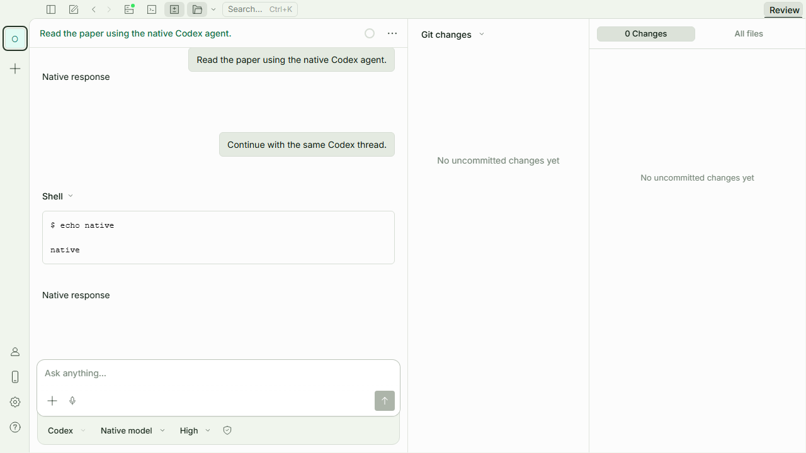
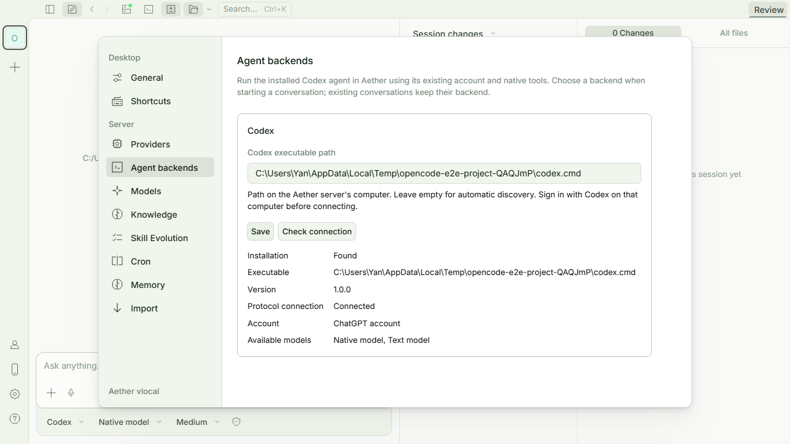
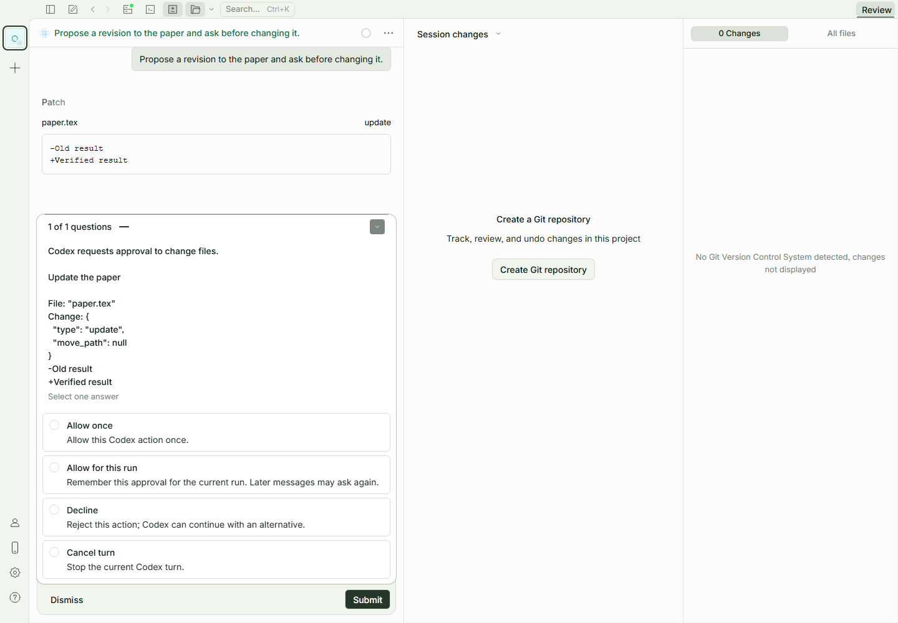

# Codex 原生智能体

Aether 可以将新会话交给本机 Codex 的 `app-server` 执行。模型调用、工具执行、上下文管理和 Codex 自身的配置由 Codex 负责；Aether 提供对话、文件与 PDF 阅读界面。现有 Aether 引擎和历史会话继续可用。

## 连接与使用

1. 在运行 Aether 后端的机器上安装 Codex，并在 Codex 中完成登录。
2. 打开 **设置 → 智能体后端**。Codex 默认开启，可用开关关闭或重新开启；点击检查连接刷新安装、连接、登录和模型状态。
3. 自动发现失败时，填写 Codex 可执行文件的完整路径并保存。留空恢复自动发现。Windows 会检查 PATH、常见 CLI 位置及 `%LOCALAPPDATA%/OpenAI/Codex/bin/*/codex.exe`；并非所有桌面应用安装方式都提供可供外部启动的入口。
4. 新对话选择 **Codex**，再选择该安装实际提供的模型和推理强度。也可以继续选择 **Aether**。

连接的是 Aether 后端所在机器上的 Codex。远程访问 Aether 时，浏览器本机安装的 Codex 不会自动成为远端的后端。设置中的路径只从 Aether 的全局配置读取；项目目录内的同名配置不能指定待执行的程序。

Codex 的全局设置保存在服务端全局配置目录的 `aether.integrations.jsonc`（默认 `~/.config/aether/`），避免旧版桌面端因不认识 `native` 字段而启动失败。本分支仍能读取主配置中已有的 `native`，独立文件中的设置优先；保存设置时仅将正在使用的主配置里的 `native` 迁出。共享文件中已有的 `latex` 会原样保留，但本分支不读取其设置、不解析其中的环境变量或文件占位符，也不提供 LaTeX 功能。此机制需要更新后端程序，只有前端热更新不会改变旧后端的保存方式。

若旧混合版本尚未完成迁移，主配置文件中仍含 `latex` 等本分支不支持的字段，配置校验会拒绝加载，本分支不会自动删除这些字段。切换前应先在混合版本中保存设置完成迁移，或备份后将对应字段移入共享配置文件。

不需要把 Codex 登录令牌粘贴到 Aether。连接检测执行握手、账户状态、模型目录查询，并在隔离目录导出协议 schema 检查自动审批、追加指令和计划模式能力，不发送推理任务。登录失效时，在 Codex 中重新登录后刷新状态。

关闭 Codex 后不再自动探测，也不能创建 Codex 会话或发送新消息；已有历史仍可查看，Aether 会话照常使用。正在执行的 Codex 任务可完成，结束后释放进程。开关、路径和保留数量都只读取全局配置。修改这些设置不重置正在运行的会话。

模型目录在后台加载，切换引擎不等待检测完成。服务端合并并发检测，成功结果缓存 60 秒，失败结果缓存 5 秒；手动检查可刷新缓存。首次检测尚未完成时会显示状态，并在可用模型确认后开放发送。

同一服务器和路径已有可用模型目录时，缓存过期或后台查询的临时网络错误不会单独阻止发送，实际派发仍由后端校验配置与模型。明确返回关闭、未连接、登录失效、检测错误或模型不可用时，界面仍会阻止发送。旧版连接接口未提供 `enabled` 字段时按默认开启处理；新开关及进程复用功能仍需要相应版本的后端，前端热更新不会更新正在运行的桌面后端程序。

## 会话与科研上下文

会话创建后固定使用所选引擎，避免切换后上下文含义发生变化。Codex 的线程 ID、模型和推理强度保存在会话元数据中，后续消息恢复同一个原生线程。恢复失败会显示错误，不会悄悄创建空白线程。

左侧在每个项目或工作区内按 **Aether、Codex** 分组，再列出各自的会话；旧会话归入 Aether。子会话仍跟随根会话，归档、未读状态和批量选择保留。分组针对当前已加载的列表，加载更多会继续补充对应组，不代表已经列出全部历史。分类本身不会授予跨会话读取等额外工具能力。

未立即要求回复的论文上下文会保留到实际派发时。连接或模型检查失败不会消费这些待发送内容；已经显示失败的普通消息需要用户重新发送。任务派发后若连接中断、执行结果不明，Aether 不自动重放输入，以免重复执行文件或命令操作。

单次原生请求的传输上限为 8 MiB。待发送上下文会在保存前预检，并预留 1 MiB 给后续问题和请求元数据；超限的新上下文不会入库。普通输入过大而未发送时，也不会消费此前排队的上下文，可以缩短问题后重试。

文本、工作区文件、图片和 PDF 上下文可传递给 Codex。上传的 PDF 会提取带页码的文本；扫描件可能没有可提取文字。模型明确声明不支持图片时，Aether 会提前拒绝；旧版本未提供能力信息时，由 Codex 校验。PDF 选中内容、提问、翻译与初读继续使用 Aether 阅读界面，并走会话所选引擎。

Codex 回复、工具状态、思考摘要和用量映射到 Aether 的会话事件中。工具执行由 Codex 负责，Aether 不再运行自己的智能体循环。显示的思考内容取决于 Codex 实际提供的摘要。用量展示根线程报告的数据，不会把子线程事件覆盖到根线程统计中，也不估算未提供的费用。

## 审批与停止

输入框中的 **Codex 权限** 按会话保存，从下一轮生效；不修改 Codex 全局配置，也不替用户回答当前已弹出的审批请求。

| 选项     | 实际行为                                                                                     |
| -------- | -------------------------------------------------------------------------------------------- |
| 请求批准 | 工作区写入沙箱；需要批准时交给用户处理。                                                     |
| 帮我批准 | 同样使用工作区沙箱，由 Codex 原生 `auto_review` 审查；可能批准、拒绝或超时。新会话默认此项。 |
| 完全访问 | 关闭 Codex 沙箱与审批提示，允许访问文件与网络。                                              |

旧会话没有保存权限时仍按“请求批准”执行。自动审批需要本机 Codex 在创建、恢复线程及每轮执行参数中明确支持；不支持或探测失败会提示错误，不能静默冒充自动审查。对话中展示收到的自动审查结果；没有返回结果的审查会标记未完成。界面选择本身不是某个操作获批的证据。

Codex 请求命令执行、文件修改或额外权限时，Aether 显示问题卡片并将选择返回 Codex。文件修改会展示原生差异；缺少可审阅差异或请求过大时会明确拒绝。Aether 原有的自动授权开关不会代替这些审批。不支持的请求会明确拒绝；不会自行扩大权限。需要输入秘密信息的问题应在 Codex 中处理。Codex 撤回请求后，对应问题卡片也会取消。

同一会话在安全完成一轮后保留独占的 `app-server` 连接，下一轮继续使用原线程和进程；新进程只初始化一次。服务端默认最多保留 **4 个空闲进程**，设置中可调整为 **0–16**；0 表示每轮完成后回收。空闲超过 **30 分钟**或超出数量时回收最久未用的进程，正在执行的任务不参与空闲数量淘汰。回收后再次发送会启动新进程并恢复持久化线程。删除会话、实例释放、停止或异常会关闭对应进程；关闭 Codex 或修改路径会回收空闲连接，并让运行中的连接在本轮完成后退出。

主线程结束后会继续等待经父子关系验证的原生子任务；子任务输出带来源标记，审批仍由用户处理。无法确认子任务完成时会保留运行状态或报告错误，不会以静默超时冒充成功。停止会中断已确认的活跃任务、清理待答问题并关闭进程；清理完成前不能开始同一会话的新一轮。进程被回收后，临时审批状态仍可能丢失并再次询问。

原生线程、App Server 进程与服务端提示缓存是三个不同层次：旧实现也会恢复同一线程，并未每轮新建对话；保留进程主要减少启动、握手和恢复开销，不能保证额度节省。[官方 App Server 文档](https://learn.chatgpt.com/docs/app-server)描述了持续连接上的多轮会话与线程卸载；这里的进程池是 Aether 自己的资源管理策略，不代表复制了 Desktop 的内部策略。[提示缓存文档](https://developers.openai.com/api/docs/guides/prompt-caching)说明缓存依赖前缀匹配等服务端条件，不能仅凭本地进程重启断言缓存失效，也不能将 API 缓存计费规则直接当作 ChatGPT 订阅额度规则。Aether 保留 Codex 返回的缓存用量，不自行估算节省比例。

## 异步提问卡片

Codex 根线程通过 `request_user_input_async` 发出的结构化问题会显示在对应回复中。每题可选择一个选项或填写自由答案；全部填写后点击提交。异步问题与命令权限审批分开，模型发出问题后可以继续执行，不会因为卡片尚未回答而自动进入同步审批的等待状态。

答案关联原线程、问题条目和题目序号。Aether 持有可追加的活跃回合时，使用原生追加接口交付；回合已结束时，在同一线程开启新一轮。启动、停止收尾或其他不可追加状态会提示稍后再提交。不会将旧问题的答案交给另一条原生线程。

题目随消息保存，答案及交付标识另行持久化。刷新、重复事件和同答案重试不会再次派发；结果不明时只核对已有记录，不自动重发。明确在派发前失败的回答可重试。已提交的回答不能原地改写，要更正时发送新的普通消息。已回答表示答案已交付，不表示后续任务已经完成。同步到 Desktop 明确保存的对应回答后，也会标记已回答。

历史刷新可恢复原生历史中带结构化字段的旧问题；没有问题字段的普通文字列表不会被猜测成卡片。原生子任务的异步问题当前仍作为文字展示。异步提问不是秘密信息输入通道。

## 追加指令、排队与计划模式

Codex 运行中，输入框继续发送的消息默认 **排到下一轮**，当前任务成功结束后按顺序执行。停止按钮单独保留，不再提供发送方式下拉选项。排队时记住模型与推理强度；权限和计划模式采用实际开始下一轮时的会话设置。

每条待发消息可点击 **立刻发送**，通过原生 `turn/steer` 补充到当前回合。只有 Aether 当前持有执行连接且本机 Codex 支持该能力时开放；它不能接管 Desktop 中正在执行的回合。发送沿用同一消息标识，并与自动出队互斥，已追加的消息不会在下一轮再发一次。如果该回合已经结束，界面会保留条目并提示核对或继续队列，不会悄悄改成新任务。

追加前后的输出分别显示在对应用户消息下，底层仍是同一个 Codex 回合。已经开始的文本或工具条目继续归属原显示段；累计用量只记录一次。历史刷新发现原生记录漏掉已显示片段或截短内容时，会标记部分同步并保留本地观察记录。旧版已删除且原生历史也没有保存的片段无法自动重建。

首版运行中追加和排队仅支持纯文字；图片、文件引用、阅读选区等会明确提示暂不支持并保留草稿。普通空闲状态下的附件发送不受此限制。待发队列最多 20 条，每条文字最多 65536 个字符，可删除尚未发送的条目。

队列独立持久化，不提前加入模型可见历史。任务失败、用户停止或服务重启后暂停，需要检查条目并点击继续。无法确认是否已经送达的输入不会自动重放；失败或结果不明的队列条目需要先核对历史并移除，再继续剩余条目。点击“立刻发送”后若网络失败，可通过 **核对发送结果** 使用原消息及回合标识确认，避免重复派发。取消过程中已经保存但未完成派发的输入会保留失败记录，而不会伪装成可直接重发的待发消息。

输入区显示启动、运行、等待用户和停止中的状态。状态描述的是 Aether 当前持有的连接，并非跨客户端的全局执行状态。

**执行 / 计划** 调用 Codex 原生协作模式（`default` / `plan`），沿用该版本提供的模式指令。选项按会话保存，切换从下一轮生效；它与审批权限分开，计划模式不是文件访问权限开关。旧版本不支持时继续提供普通执行模式，并说明计划模式不可用；不能确认已处于计划模式的线程能够切回普通模式时，发送会明确报错。

## 上下文与账户额度

上下文占用按 Codex 最近报告的输入 token 与上下文窗口计算，不用整段对话累计 token 猜测。保留原生返回的输入、输出、缓存及总 token；不把推理 token 再加进已经包含它的总数。原生线程没有报告窗口或用量时显示未知，费用也不会显示为推算出的金额。

会话上下文面板可查看 Codex 返回的账户额度与重置时间，支持手动刷新。读取使用独立的短时连接，只调用账户额度接口，不运行推理；成功结果缓存 60 秒，不可用结果缓存 5 秒。额度属于登录账户，并非本会话独享；缺失或不支持的数据明确显示不可用。

## 原生历史刷新

打开已有 Codex 会话、Aether 中一轮生成完成后，界面会异步读取原生线程历史；也可点击 **刷新 Codex 历史**。自动刷新合并十秒内的重复读取，手动刷新绕过该缓存。普通消息接口、搜索及导出读取最近一次展示缓存，不会自行拉取全部原生历史。

读取使用独立的短时 `app-server` 连接，通过 `thread/read`、`thread/turns/list` 和必要的 `thread/items/list` 分页取数，不恢复线程、不发送模型请求。其他客户端已保存的完整回合可以导入 Aether；重复刷新不会新增相同消息。它不是 Desktop 的逐字实时同步，也没有建立跨客户端执行互斥，仍应避免两端同时发送或审批。

原生完整历史是 AI 内容的来源。Aether 独立保存待发输入、交付账本、引用与附件关联、原回复标识及收到的用量和自动审查记录；消息表只是展示投影。普通发送不再从这张缓存表推断哪些输入尚未交付。数据库事务保证账本和缓存更新一起提交或回滚；旧会话的发送游标无法解释时会停止迁移并保留原记录，不猜测重发。

读取最多处理 100 页、10000 个 item、32 MiB 数据，设置超时。遇到接口不支持、未知内容、未完成回合、分页异常或原先已确认的回合缺失时，保留旧记录和同步诊断；“部分历史”状态不在对话栏或刷新按钮提示中展示，历史不可用时仍提示检查连接后重试。新发现的未知条目以原始信息显示。部分读取追加的内容不能保证完整原生顺序，完整读取后再统一排列。外部回退、压缩等造成旧回合消失时，目前仍保守保留缓存，尚未提供清缓存按钮。

外部历史若缺少逐轮模型或用量，Aether 不根据当前默认模型猜测，也不把占位的零值当成真实零消耗。本地图片路径可保留，但浏览器未必能展示外部客户端的 `file://` 图片；图片文件 ID、未完整展开的原生子任务等会标记部分同步。历史中的 Aether 引用保留原消息标识。

删除 Aether 会话不删除 Codex 原生线程。已绑定原生线程的会话，其 Aether 上传附件和阅读文件会保留，避免 Desktop 后续读取失效；这些保留资源暂未提供自动清理流程。

## 当前边界

- 这是 Codex 引擎接入，不是控制已有 Codex Desktop 窗口，也不承诺复现 Desktop 独有的界面、插件或当前打开的会话。
- 使用 Codex 自己的工具与配置；Aether 专属的知识库检索、技能演化、工具覆盖及旧斜杠命令不接入原生线程。
- 原生会话暂不支持 Aether 的分叉、回退、修改/删除单条历史、手动压缩和 shell 模式，以免界面记录与 Codex 线程分歧。可创建新会话或删除整个会话。
- 原生会话可导出记录，但暂不支持从 Aether 备份恢复为可执行的原生线程。导出的记录不能代替 Codex 自己的线程存储。
- 此阶段仅支持 Codex，其他原生引擎和 Overleaf 不在本次实现中。

## 维护与验证

协议处理位于 `packages/opencode/src/native/`，安装诊断接口为 `GET /native/codex`，历史刷新接口为 `POST /native/codex/:sessionID/history`。会话的可空 `engine` 列兼容旧数据库；没有该字段的会话仍使用原引擎。新增 `native_state`、`native_input`、`native_dispatch` 保存迁移状态、输入和交付证据，并兼容旧数据库已登记但未实际运行新迁移的情况。

`packages/opencode/test/native/` 覆盖真实子进程 JSONL 通信、异常退出、进程树清理、线程恢复、审批与提问、中断竞态、附件和 PDF 提取、旧库升级及阅读会话引擎隔离。前端测试覆盖安装设置、模型选择与发送流程。测试使用独立数据目录，不依赖用户真实账户。

运行控制接口为 `GET /native/codex/:sessionID/runtime`、`POST /native/codex/:sessionID/steer` 及 `/native/codex/:sessionID/queue` 下的排队、删除和继续操作；账户额度为 `GET /native/codex/usage`。追加输入沿用原生交付账本记录送达证据；待发队列保存在服务端数据目录 `native-queue/<projectID>/<sessionID>.json`，原子写入并在执行服务重启后暂停。定向回归覆盖同 ID 重试、陈旧回合拒绝、模式切换、停止后不续发、队列恢复及缺失用量，不替代真实安装版本的交互验收。

以下截图来自确定性的协议测试进程，模型名称与回复为测试数据：

Codex 协议以安装版本支持的 `app-server` 为准。升级后应重新运行协议测试和真实安装的连接验证。SDK 使用仓库的 `packages/sdk/js/script/build.ts` 从服务端 schema 重新生成。

关于跨客户端历史、实时事件与执行归属，见 [2026-10-26 互通验证](native-codex-interop.zh-CN.md)及[历史数据设计与实施范围](native-codex-history-design.zh-CN.md)。设计中尚未实现的能力单独列出，不代表已经接入 Desktop 私有通信。
