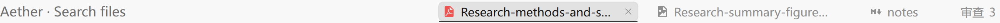

# 标题栏文件标签

每个文件标签始终限制宽度：通常最多 240px，空间不足时进一步收紧到 150px；文件较多时通过“更多文件”菜单访问其余标签。单个长名称也会省略显示，悬停可查看完整路径。



原先只有整组标签超出标题栏预算时才限制到 150px，因此同一个长文件名在不同窗口宽度、打开数量下可能完整展开。现在宽松布局也限制单项长度，保留既有的紧凑布局与溢出菜单。

标签测量后恢复临时样式，实际宽度变化会参与重新计算，避免字体或界面变化后沿用过期结果。此调整不改变文件标签的打开、关闭和拖动排序方式。

## 定向验证

从 `packages/app` 运行：

```powershell
bun test src/pages/session/file-tab-fit.test.ts
bun run ./script/vitest.ts run --config ./vitest.config.ts src/pages/session/session-side-panel.vitest.tsx
bun typecheck
```

标签样式位于 `packages/ui`，该包运行 `bun typecheck`。实际浏览器检查使用生产样式，覆盖单个长文件名、长短混合、较窄窗口、字体加载后重新测量、省略显示、关闭按钮和溢出菜单。
