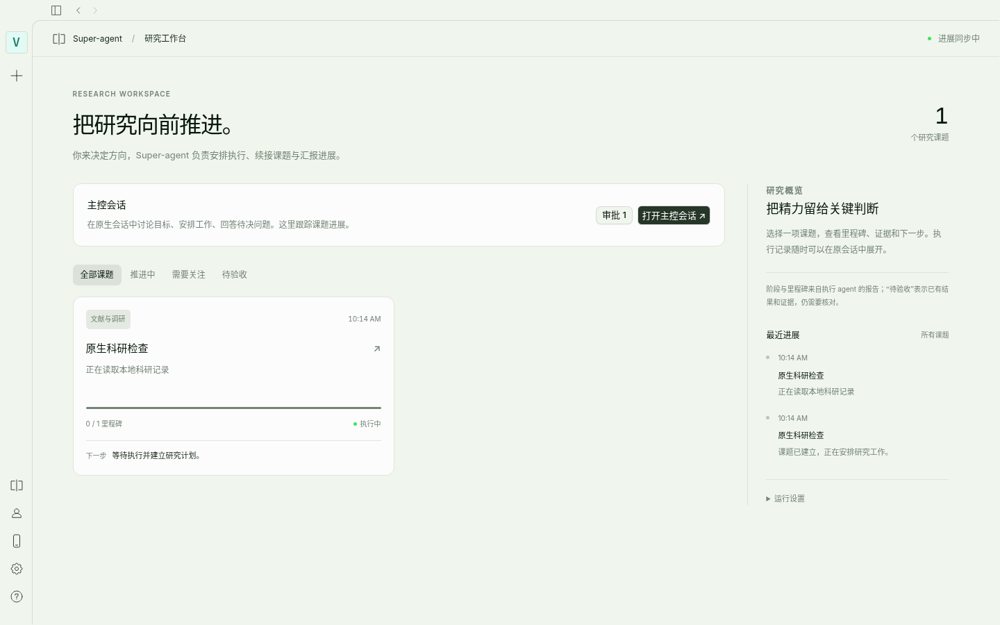

# Aether Super-agent

English | [简体中文](README.zh-CN.md)

An opt-in research coordinator: discuss and assign work in a native Aether conversation, then track milestones, evidence and blockers in a separate research panel. The coordinator selects an existing worker session or creates a task with its own Git worktree. Workers report progress through an authenticated plugin tool; significant results return to the main conversation through a durable queue.

This directory is self-contained and excluded from the root workspace. Adding it to the repository does not enable Super-agent or change the default Aether UI. Its optional installer adds reversible source mounts; it is not a runtime UI extension API.



## Try it

Requires Linux/macOS, Bun 1.3.10+, Git, an Aether source checkout with dependencies installed, and a configured Aether model. The coordinator runs on the same machine as Aether. The research repository must have a commit.

From this directory (or a standalone copy of it):

```sh
bun install --frozen-lockfile
bun run setup --repo /absolute/path/to/research-project \
  --state /absolute/path/outside/project/superagent-state \
  --aether http://127.0.0.1:19527
bun run install:aether --aether /absolute/path/to/Aether --config config.local.json
bun start config.local.json
```

Build/run Aether from the modified source checkout. Existing packaged binaries do not load these source changes; existing backend instances may need to reload plugin configuration. Refresh the browser after an upgrade. Open **研究工作台** (Research workspace) from the sidebar, then **打开主控会话** (Open coordinator conversation). The prototype's panel labels are currently Chinese. Settings → Super-agent provides enable/disable, scheduled check-ins (off by default), and guarded uninstall.

Model credentials stay in Aether. Use `setup --model provider/model` to choose a model, and `AETHER_AUTHORIZATION` if the backend requires Basic authentication. Never commit `config.local.json`, tokens, installation receipts or research state.

## Integration and boundaries

The installer supports `Science-Discovery/Aether dev@a0926a8260e407338a2b7f21b9e27316599bca4e`. It validates anchors before writing, copies the add-on UI and bridge, installs a plugin and two agent presets, and adds marked blocks to five source files: the sidebar, app router, layout, settings dialog and server router. It leaves provider, prompt and database implementations alone. The browser uses Aether's authenticated bridge and never receives the coordinator token.

Task trust is explicit and revocable. It grants full permission to that worker session, including operations outside its worktree; it is not an OS sandbox. Other tasks stay subject to their own approvals. Approvals are available on demand in a native dialog. Reload/reconnect synchronizes confirmed task permissions with Aether's native UI cache, avoiding transient prompts for trusted work without suppressing other permission notifications.

SQLite records dispatch intent before network calls. Unknown delivery is reconciled using message identity instead of blindly repeated. Research progress is agent-reported evidence, not scientific acceptance. A finished model turn or stopped session does not prove a background calculation finished. The optional scheduler checks existing tasks in a separate conversation and reports only meaningful updates.

The settings uninstall checks running work and managed trust first, then removes only recorded files and marked blocks. Research data and sessions remain. The CLI below only restores files: revoke task trust, disable dispatch and confirm workers are idle before using it.

```sh
bun run uninstall:aether --aether /absolute/path/to/Aether
```

Edited integration files cause a conflict rather than being overwritten. Upgrade by uninstalling the old integration and installing the new version. See the [detailed guide](README.zh-CN.md) for recovery, API and installation limits.

## Verification

Run from this directory, never the repository root:

```sh
bun test
bun typecheck
bun run test:permission-cache
bun test/native-v2-e2e.ts /absolute/path/to/Aether
bun test/native-permissions-e2e.ts /absolute/path/to/Aether
```

The browser scripts require `agent-browser` and its browser, plus installed Aether dependencies. They create isolated checkouts and services, use a local deterministic model, and do not require a paid API key. Pass the Aether checkout explicitly; the legacy default expects a standalone sibling checkout. `NATIVE_E2E_CRON=1` adds two real scheduler cycles to the native-v2 check. Desktop binaries are not covered by these Web tests.

Real-model verification is opt-in: `DEEPSEEK_API_KEY=... bun test/native-live.ts /absolute/path/to/Aether`. It checks a small Python repair and a read-only CSV summary, not scientific discovery quality.
