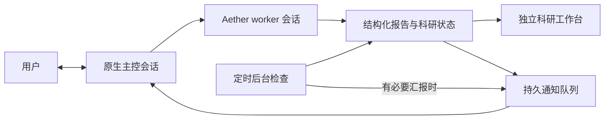

# aether-superagent

[English](README.md) | 简体中文

独立的 Aether 科研协调模块：**原生主控会话 + 独立科研工作台 + 设置页面**。用户在主控会话中讨论和安排工作，主控自主决定新建课题或续接已有 worker。工作台只呈现进展、里程碑、证据和待决事项，不复制聊天记录。

主控是正常的 `superagent` primary agent，通过 `superagent_status`、`superagent_dispatch`、`superagent_stop` 工具协调工作，并在原生聊天中给出自然语言回答。每个课题有自己的 Git worktree 和 Aether 会话。worker 使用 `superagent_report` 主动报告；普通进度只更新工作台，结果和重要阻碍经持久队列送回主控。



## 安装和使用

需要 Linux/macOS、Bun 1.3.10+、Git、已安装依赖的 Aether 源码 checkout，以及已配置模型的 Aether 后端。协调器和 Aether 在同一台机器。安装和启动时不需要指定研究项目，也不要求预先建立 Git 仓库。

在 Aether 仓库内先进入 `extensions/aether-superagent`；该目录也可单独复制使用。模块不加入默认 workspace，不会自动安装或启动。以下命令均从模块目录执行。

```bash
bun install --frozen-lockfile
bun run setup --state /absolute/path/to/superagent-state \
  --aether http://127.0.0.1:19527
bun run install:aether --aether /absolute/path/to/Aether --config config.local.json
bun start config.local.json
```

`setup --model provider/model` 可选择模型。API key 始终由 Aether 管理，协调器不保存模型密钥。Aether 开启 Basic 认证时，协调器通过 `AETHER_AUTHORIZATION` 环境变量获得凭据。

在 Aether 侧栏打开“研究工作台”，点击“打开主控会话”，即可使用原生聊天界面安排工作。首次打开会设置该会话的 Super-agent 角色。点击课题的“查看执行会话”进入原生 worker 会话，查看工具、审批和执行细节。

升级后请刷新浏览器，让已有页面重新读取角色和模型列表。安装器使用目标 checkout 自带的插件工具接口，不覆盖全局目录中已有的插件依赖。

在 **Aether 设置 → Super-agent** 中：

- **启用 Super-agent**：关闭后暂停新派工及通知投递，已执行的工作继续保存和核对结果。读取、停止、核对仍可使用；开关不会强行杀死已有研究计算。
- **定时检查**：默认关闭，间隔为 1–1440 分钟。开启后允许后台主控检查已有任务、追问和协调；有必要才回到用户主会话汇报。无须汇报时记录 `NO_UPDATE`，不产生用户主会话提醒。
- **卸载 Super-agent**：二次确认后先冻结调度，再核对活动会话；运行中或执行状态无法确认时拒绝移除，并保持停用。卸载保留会话、研究数据库、任务 worktree 和模型凭据。重新安装后可重新启用，不必删除旧数据。

后台检查使用单独的内部会话、同一主控角色及课题状态；它只能处理已有授权课题，不能借定时器新建无关研究任务。后台检查本身会消耗模型用量。外部消息渠道不在此版本范围内。

### 在对话中接管项目

直接告诉主控：“请监控 `/home/user/research/project-a`，汇报计算进展。”主控派工时会携带该目录，后台在首次执行时检查 Git：已有仓库则沿用，目录属于上级仓库或 linked worktree 时保留用户指定的监控范围；没有则在项目目录初始化 Git。没有提交的仓库会建立一个空的初始提交。

**不会自动 `git add` 或提交项目文件，不改动已有暂存区、未提交修改和 Git 身份配置。** 空初始提交不是项目备份；任务的隔离 worktree 不会自动包含未跟踪文件。监控任务会读取原项目目录的实时内容，包括未提交文件和计算输出。项目目录须已存在，路径不明确时主控会询问，不猜测目录。

安装、启动、普通对话和查看状态都不会建立项目仓库。不同任务可以绑定不同项目，续接时沿用原项目与会话；工作台显示每个课题的项目目录。状态目录必须放在项目仓库之外。

旧版 `repo` 配置仍可作为可选默认项目，`setup --repo /path/to/project` 也继续支持。删除默认项目配置不会改变已有任务归属，旧会话和 worktree 继续使用。

工作台同时显示主控会话的实际状态：正在处理、空闲、尚未关联或暂不可用。普通聊天不伪造科研课题；主控尚未派工时会明确说明。在已有原生会话选择 Super-agent 角色，也会在用户回合开始时关联到工作台。需要检查文件或执行操作时必须通过派工登记课题，主控会话即便使用完整权限也不能绕过这条路径。用户已附上的内容仍可直接讨论；仓库准备失败会在课题卡片显示具体原因。

### 集中审批与任务信任

研究工作台只显示紧凑的「审批 N」入口；没有待审批时显示「任务权限」。点击后打开 Aether 原生弹窗，集中允许一次、拒绝或管理任务信任，无须逐个打开会话。弹窗不会自动打开，可按 Esc 关闭；关闭不影响后台自动审批。读取失败时入口显示「状态未知」，不会把未知状态显示成零请求。无待审批的普通任务默认收起。

选择「信任此任务」并确认后，只为这个任务的执行会话启用 Aether 完整权限，自动处理该任务当前及后续的审批；其他任务和主控的权限不变。该授权覆盖命令执行、文件读写，并不是限制在 worktree 内的操作系统沙箱。模块不使用 Aether 的工作区级 `always` 批准，也不默认信任新任务。

信任状态在协调器重启后保留，并核对 Aether 的实际权限。撤销会停止自动审批、恢复逐项审批，并暂停仍在运行的执行会话；确认空闲后才报告撤销完成。已完成的操作不会回滚，外部后台进程不保证随会话停止。卸载前须撤销模块管理的任务信任。

授权前会准备对应执行会话的原生权限缓存；页面刷新或重连后会读回实际权限，避免后台已信任而前端仍显示短暂审批通知。同步不会隐藏浮窗或新增授权，旧回包不能覆盖较新的权限事件。未信任任务和撤销后的任务仍正常提醒；只选择「允许一次」不会自动信任后续操作。

被中断的回合可能保留为「投递待核对」；请核对已有执行结果后再决定下一步。撤销权限不代表任务完成，系统不会自动重派这类回合。

当前 Aether 的公开 API 不能任意恢复自定义权限规则，因此仅对原本使用默认逐项审批、且没有自定义会话规则的任务提供信任功能。安全模式、自定义规则和在 Aether 中另外授予的完整权限不会被覆盖；这些会话仍可在工作台逐次审批。发现外部修改或无法核对状态时，模块显示待核对，不自动覆盖用户权限选择。

## 可逆集成范围

当前 Aether 没有通用运行时 UI 扩展接口，安装器自动在以下五个文件增加有标记的挂载块，用户不需要手工修改 Aether：

- `packages/app/src/pages/layout/sidebar-shell.tsx`：侧栏入口。
- `packages/app/src/app.tsx`：独立工作台路由。
- `packages/app/src/pages/layout.tsx`：工作台导航保护。
- `packages/app/src/components/dialog-settings.tsx`：设置标签和页面。
- `packages/opencode/src/server/server.ts`：本机协调器桥接。

另外复制独立前端组件、后端桥接文件，并在 Aether 全局配置目录添加一个 plugin 与两个 agent preset。现有 prompt/provider/数据库代码不改动。兼容基线：`Science-Discovery/Aether dev@a0926a8260e407338a2b7f21b9e27316599bca4e`。挂载点不匹配时拒绝写入。

**已打包的旧应用不会读取新增源码，需要构建使用这份 checkout 的 Aether。** 插件配置在工作区加载时读取；已有实例不会承诺热加载。新增主控使用独立目录，避免改动已有项目配置。自动浏览器验收覆盖 Web，桌面安装包需另行构建验证。

bridge 默认在 `~/.config/aether/superagent.json`（遵循 `XDG_CONFIG_HOME`），只包含协调器地址及 token 文件路径。插件与 bridge 用状态目录中的私有 `control.sock` 通信；浏览器从未获得协调器 token。`--bridge-file` 自定义目录必须对应 Aether 实际加载的配置目录，并设置后端 `AETHER_SUPERAGENT_CONFIG`。源码 UI 和协调器使用的后端地址必须一致，包括 hostname、端口和 base path。

```bash
bun run uninstall:aether --aether /absolute/path/to/Aether
```

设置页卸载含运行状态检查。上面的 CLI 是文件集成恢复工具，使用前先撤销任务信任、停用调度并确认没有执行中的任务；CLI 不执行设置页的运行状态检查。安装清单位于 checkout 的 Git 目录；卸载只删除清单内新增文件和标记块，保留块外用户编辑。手动修改过的集成文件会触发冲突拒绝，不强行覆盖。中断的卸载可继续；升级先卸载旧集成再安装新版本。清单不是研究数据备份，模块不会删除研究数据库或 worktree。

## 科研与执行状态

研究阶段包括 `planning`、`research`、`deriving`、`computing`、`verifying`、`blocked`、`review`，允许根据新证据回到较早阶段。快照保存目标、当前摘要、下一步、阻碍、里程碑、证据引用、时间及版本号。

`review` 要求里程碑完成、证据非空且无未解决阻碍，但仍是 agent 报告，不代替科研验收。一次模型回合结束、后台进程结束和研究结论成立是三件不同的事。工作台不根据运行时间估算完成百分比。

原生报告绑定真实 session、目录、assistant message、tool call、ticket 和 run，版本严格递增。旧轮次或停止后的报告不能更新当前课题。worker 不需要知道 token。普通进度不唤醒主控；最终报告也不提前释放运行槽，必须等待 Aether 执行终态。worker 漏报时保存实际答案并标记需要核对。

## 可靠交付和恢复

- SQLite 在调用 Aether 前保存意图。每个课题串行，默认最多两个 worker；主控和后台检查有独立通道。
- HTTP 409 才重新排队；超时或未知响应进入待核对，按固定 message ID 读回，不盲目重派。服务重启恢复未确认通知；未知投递可能需要人工核对，不能宣称任意外部副作用精确一次。
- 结果关联验证原始 parentID；对 Aether 已知自动压缩流程验证完整关联链，保留最终原始 parentID 溯源。摘要不冒充最终回答。
- 停止持久禁止该课题继续派工。Aether abort 不等于外部后台进程已终止；需要单独核对实际计算进程。
- 研究数据库新增表，保留旧工单及会话。旧 JSON Router/进度文件协议仅用于兼容旧记录和 CLI，不再作为新工作台交互方式；停用开关同时约束旧入口。
- 旧工单在主控明确续接时绑定归属；已有工作区尚未加载报告插件时，继续用旧执行协议回收真实答案和进度。新工单使用原生报告工具，不要求重启已有研究会话。
- 每个新工单从该任务项目绑定的固定 commit 建立 worktree；不会复制原仓库未提交修改，也不会重置已存在的任务目录。
- worktree 是编辑隔离，不是操作系统沙箱。Aether 原有权限仍然生效。不要把该原型作为不可信多租户服务。

## API

浏览器通过 Aether 认证 bridge；CLI 和 plugin 使用本机 token。原生工具接口不在浏览器 bridge 白名单内。

| 接口 | 用途 |
|---|---|
| `GET /panel/state` | 科研快照、执行输入、设置及通知状态 |
| `POST /native/open` | 打开原生主控会话 |
| `POST /native/settings` | `{enabled?,schedule?:{enabled,minutes}}` |
| `POST /native/uninstall` | `{confirm:true}`，安全移除集成 |
| `POST /native/permissions` | 读取任务会话的待审批请求和信任状态 |
| `POST /native/permission` | `{ticket,request,reply:"once"\|"reject"}`，处理已核实归属的请求 |
| `POST /native/trust` | `{ticket,trusted,confirm:true}`，授予或撤销该任务信任 |
| `POST /native/tool` | plugin 专用，验证真实工具执行上下文 |
| `GET /tickets/:id/open` | 核对后返回 worker 会话定位 |
| `POST /tickets/:id/stop` | 停止派发并请求取消 |
| `POST /inputs/:id/reconcile` | 只读核对不确定执行 |
| `POST /inputs/:id/dismiss` | `{confirm:true}`，核对后放弃等待 |

为兼容已运行的旧 bridge，前端将原生管理操作封装为 `/requests` 的 `native` envelope，只接受已定义的管理操作；不允许从这个通道伪造工具调用。权限操作由服务器从 ticket 解析会话和目录，不接受调用方指定的路径或会话。旧 CLI `/requests {key,text}`、`/tickets` 和续接接口保留。

## 验证

插件权限测试需要已安装依赖的 Aether 源码。会自动查找所在仓库或同级 `Aether` 目录；其他位置请使用 `AETHER_SOURCE=/absolute/path/to/Aether bun test`。

```bash
bun test
bun run test:permission-cache
bun run typecheck
bun test/native-v2-e2e.ts /absolute/path/to/Aether
bun test/native-permissions-e2e.ts /absolute/path/to/Aether
```

两个 `native-*-e2e.ts` 脚本需要 `agent-browser` 与浏览器，使用隔离 checkout、真实 Aether 服务、真实 plugin 工具及本地确定性模型，覆盖原生聊天、派工与回报、Panel、设置开关和卸载。普通测试不消耗模型额度。

加上 `NATIVE_E2E_PROJECTS=1` 可验证无仓库启动、按需初始化 Git、多项目及原会话续接。加上 `NATIVE_E2E_CRON=1` 可额外等待两个实际定时周期，验证无变化保持静默、有重要发现回到主会话汇报。

```bash
DEEPSEEK_API_KEY=... bun test/native-live.ts /absolute/path/to/Aether
```

真实模型验收是显式 opt-in：修复带既有测试的 Python clamp，以及只读精确 CSV 汇总，并检查 worker 报告回到原生主会话。请通过自己的安全环境配置密钥，不把它写入仓库或日志。这是小任务闭环验收，不是科研发现能力评测。旧版验收脚本仅保留作兼容参考。
